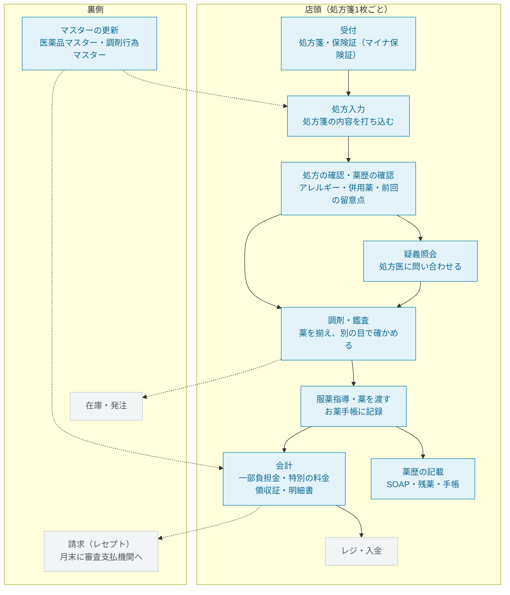
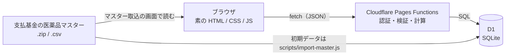
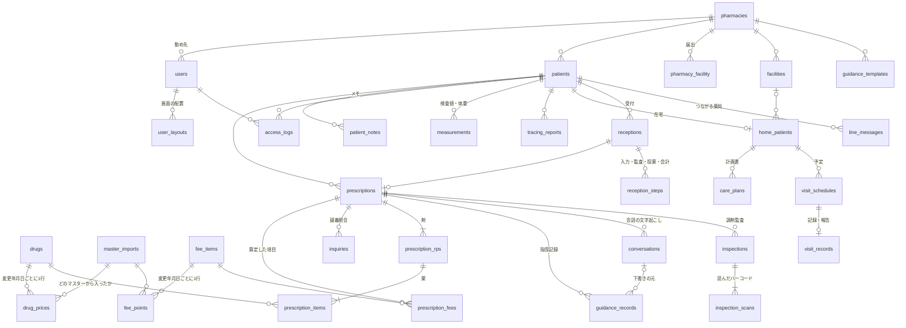

# 薬剤料計算・薬歴

薬価・調剤報酬の改定があっても正しい会計を出し続ける、小さな調剤業務Webアプリです。

調剤システムは、薬価が毎年（年度の途中にも品目ごとに）、調剤報酬が2年ごとに改定されるたびに追従しなければなりません。このアプリでは、その中心にあたる「同じ処方でも、調剤した日付によって使う薬価と点数表が変わる」部分を、レセプト請求に使われる実データ（支払基金の基本マスター）で作りました。

要件定義の資料：[docs/要件定義_2.pptx](./docs/要件定義_2.pptx)（何ができるか・想定した状況・業務の流れのどこを担うか・元にした情報・想像で補った所・どう作ったか）

- **薬価マスタは実データ**：社会保険診療報酬支払基金の「医薬品マスター」（レセプト電算処理システムの基本マスター）の内用薬を、令和7年度版の最終から令和8年10月13日公表分まで公表順に取り込みました（12,593コード・薬価の履歴22,868行）
- **マスターを画面から入れるだけで最新になる**：支払基金が公表する全件ファイル（.zip）・改定分ファイル（.csv）をドロップするだけです。品目ごとの適用開始日（変更年月日）・廃止年月日・経過措置の期限はマスターが持っているので、日付を指定する必要はありません
- **改定にも年度途中の変更にも追従する**：薬価を「適用開始日つきの履歴」として持ちます。調剤日を2026-03-31にすると旧薬価、2026-04-01にすると新薬価、11月1日に変わる薬は11月1日から新薬価で計算します
- **会計まで出す**：調剤基本料・薬剤調製料・調剤管理料・服薬管理指導料などの調剤報酬を調剤日の点数表で算定し、一部負担金と窓口で受け取る額を出します。点数も支払基金の**調剤行為マスター**から取り込みます（令和8年6月1日の調剤報酬改定の前後をまたいで計算できます）
- **処方箋の記載と、実際に渡したものを分けて記録する**：一般名処方の銘柄選択・後発品への変更・残薬調整で日数を減らした場合・疑義照会の内容と回答
- **領収証・明細書とお薬手帳**：通知の様式に合わせた領収証と調剤明細書、紙の手帳に貼る内容と電子版お薬手帳に読み込ませる QR コード（JAHIS 形式）
- **長期収載品の選定療養**：患者が希望して先発品を受け取ったときの薬剤料（保険給付の分）と特別の料金を、調剤日に有効な計算方法で出します
- **キーボードだけで入力できる**：処方入力はマウスを使わずに最後まで打ち込めます
- **再来局した患者の情報を1画面で見渡せる**：アレルギー歴・副作用歴、前回の指導記録の留意点（P）、来局をまたぐメモを、薬歴と同じ画面に出します
- **患者情報への接触を記録する**：誰が・いつ・どの患者を開いたかを全て記録します
- **画面ごとのチュートリアル**：各画面を初めて開いたときに、説明する部品だけを明るく残して使い方を案内します
- **kusudamaクラウド薬歴・ホルトノキの機能**：服薬指導の会話の録音と文字起こし、SOAP の下書き、指導内容の提案、検査値、在宅訪問、トレーシングレポート、バーコードでの調剤監査、受付から会計までの進み具合、処方箋単価と後発品の使用割合、つながる薬局（LINE）、多要素認証、小児の分量チェック。AI が担う部分は固定の結果か決まった規則で動かしています（下の「[kusudamaクラウド薬歴・ホルトノキの機能](#kusudamaクラウド薬歴ホルトノキの機能2026-11-追加)」）

## 画面

| 画面 | できること |
|---|---|
| 患者一覧 | 患者番号・氏名・カナ（ひらがな可）で検索、新規登録（負担割合を含む） |
| 受付状況 | 処方箋の受付、受付 → 入力 → 監査 → 投薬 → 会計 の進み具合と待ち時間 |
| 薬歴 | 上の段に患者・注意点（アレルギー歴・副作用歴・疾患・併用薬を1つの表に）・次に確認すること・今の処方・生活・検査値、その下に処方の推移、いちばん下に経過（並べ方は「折り返し」か「1〜3段の帯（左が新しい）」を選べる）。箱の高さは中身に合わせ、箱の中ではスクロールさせない。入りきらないときは画面全体を1本のスクロールで動かす。文字の大きさはほかの画面と同じ。「配置を変える」で箱をほかの箱の上へ動かすと割り込み、後ろの箱が押し出される（iPhone のホーム画面と同じ）。幅と段数も変えられ、利用者ごとに保存する。来局日ごとの処方・処方箋との違い・疑義照会・会計、指導記録（SOAP）、来局をまたぐ患者メモ、検査値・体重。`Alt+D` で前回の処方を複写（前回Do）。指導記録を書く画面で、会話の録音と文字起こし・下書き・指導内容の提案・テンプレート・つながる薬局のメッセージ |
| 処方入力 | 薬の候補検索、剤ごとの点数、会計（調剤報酬・一部負担金・特別の料金・窓口で受け取る額）を入力しながら表示。処方箋と違う調剤（`Alt+H`）、疑義照会（`Alt+Q`）、お薬手帳の提示。改定をまたいだ比較。小児の分量チェック |
| 調剤監査 | 取り出した薬の箱のバーコードを読み、処方の薬・有効期限と照合する |
| トレーシングレポート | 処方医への服薬情報提供書を作って印刷する |
| 在宅 | 施設・在宅の患者・計画書・訪問の予定（回数の上限）と記録・処方医への報告書の一括印刷 |
| つながる薬局 | 患者との LINE のやり取り（実際のサービスとはつないでいない。受信はデモ） |
| 薬局の数字 | 月ごとの処方箋の枚数・処方箋単価・後発医薬品の使用割合（数量ベース） |
| アカウント | 多要素認証（認証アプリの6桁）の設定 |
| 領収証・明細書 | 薬歴のカードから開く。領収証（費用区分ごとの点数・負担額・保険外負担）と、算定項目ごとの調剤明細書を印刷する |
| お薬手帳 | 薬歴のカードから開く。紙の手帳に貼る内容と、電子版お薬手帳の QR コード（JAHIS 形式）を印刷する |
| 薬価照会 | 薬ごとの薬価の履歴（適用開始日・薬価・前回比・経過措置・どのマスターから入ったか）。（選）のコードは価格差も |
| 閲覧記録 | アクセスログ。患者ごとにも絞り込める |
| マスター取込 | 支払基金の医薬品マスター（薬価）・調剤行為マスター（調剤報酬の点数）をドロップして更新。反映する前に、変わる行・これから効く変更・新しいコード・廃止を確認できる |

## 業務の流れと、このアプリが担う範囲

保険薬局で処方箋を受け付けてから、薬を渡してお金を受け取り、月末に請求するまでの流れです。**青がこのアプリで作った部分**、灰色は作っていない部分（実際の薬局では、レセコン・調剤機器・レジ・請求のシステムなどが担う）です。



| 流れ | このアプリでやること | やらないこと |
|---|---|---|
| 受付 | 患者の登録（氏名・生年月日・性別・負担割合）。処方箋の受付と、業務の進み具合・待ち時間 | 保険証・マイナ保険証の資格確認（オンライン資格確認）、処方箋の2次元バーコード・電子処方箋の読み取り |
| 処方入力 | キーボードで打ち込む。調剤日の薬価で薬剤料を出す。処方箋の記載と、実際に渡した薬・量・日数を分けて持つ | 内服薬以外（頓服・外用・注射） |
| 処方の確認・薬歴の確認 | 薬歴の画面で、アレルギー歴・副作用歴、前回の留意点、今の処方を1画面で見る | 相互作用・重複投薬の自動チェック |
| 疑義照会 | 問い合わせた内容・回答・処方が変わったかを記録し、加算に反映する | 処方医への連絡そのもの |
| 調剤・鑑査 | 薬の箱のバーコード（GS1）で、取り出した薬が処方と合っているかを照合する。小児の分量を体重当たりで確かめる | 一包化・散剤の計量、カメラでのバーコードの読み取り、調剤包装単位（PTP シート）のバーコード |
| 服薬指導・お薬手帳 | 指導記録（SOAP）を書く（会話の文字起こし・下書き・提案・テンプレート）。紙の手帳に貼る内容と電子版お薬手帳の QR コードを出す。処方医へのトレーシングレポート | 薬剤情報提供書（薬の写真・効能・副作用の文書）、本物の音声認識 |
| 会計 | 調剤報酬の算定、一部負担金、選定療養の特別の料金、窓口で受け取る額、領収証・明細書 | 公費負担・高額療養費・自己負担上限、レジ・POS への連携（実際は、レセコンが負担額をレジに送るか、領収証のバーコードをレジで読む） |
| 請求 | — | レセプト（調剤報酬明細書）の作成と月末の請求 |
| マスターの更新 | 支払基金の医薬品マスター・調剤行為マスターを公表されるたびに取り込む（実際の薬局では、レセコンのメーカーが配信する） | — |
| 在宅 | 訪問の計画書・予定・記録・処方医への報告書 | 在宅の点数（在宅患者訪問薬剤管理指導料）の算定 |

デモ用アカウント：ログインID `demo` ／ パスワード `pharmacy-demo`。もう1つの薬局の人として `demo2`（パスワードは同じ）でも入れ、互いの患者は見えません。患者・メモ・指導記録はすべて架空です。

各画面を初めて開くと、その画面のチュートリアルが流れます。説明する部品だけを明るく残し、それ以外を暗くします。進む・戻るは吹き出しの「次へ」「戻る」ボタンだけで（読み飛ばし防止のため、画面のクリックでは進みません）、`Esc` で終了です。右上の「チュートリアル」ボタンで再生できます。

## kusudamaクラウド薬歴・ホルトノキの機能（2026-11 追加）

株式会社ズーのクラウド型電子薬歴「kusudamaクラウド薬歴」（2024年8月発売）と、その前のクラウド薬歴「ホルトノキ」（2022年8月発売）がプレスリリース・製品ページで挙げている機能を、このアプリにも作りました。名称・画面・ロゴは真似していません。AI が担う部分は、AI を呼ばずに**固定の結果か、決まった規則**で動かしています（どこが固定かは下の表）。AI の代わりをしている所は [src/server/ai-stub.js](./src/server/ai-stub.js) の2つの関数だけで、本物にするならそこで外部の API を呼びます。

| 機能（元にした製品） | このアプリでの作り | 中身 |
|---|---|---|
| 指導内容の提案（kusudama：AI） | 指導記録を書く画面の右側 | 決まった規則（[guidance-suggest.js](./public/assets/js/guidance-suggest.js)）。薬効分類（YJコードの先頭4桁）ごとの注意、新しく始まった薬・中止した薬、アレルギー歴と同じ系統の薬、eGFR が低いときに注意する薬、高齢者のベンゾジアゼピン系、前回の留意点・残薬。根拠も一緒に出す |
| 会話の録音と文字起こし（kusudama：AI）・録音ファイルの後からの読み込み | 指導記録を書く画面の右側 | 録音（ブラウザの MediaRecorder）とファイルの読み込みは本物。**文字起こしは固定の文**（その来局の薬の名前だけ入れる）。音声は保存しない |
| SOAP の下書き（kusudama：AI） | 「下書きを作る」（`Alt+G`） | 決まった規則（[soap-draft.js](./public/assets/js/soap-draft.js)）。S＝患者・家族の発言、O＝処方の変化・90日以内の検査値・残薬の発言、A・P＝指導内容の提案。下書きから書いた記録には印が残る |
| 会話から既往歴・アレルギーなどを拾う（kusudama：AI） | 文字起こしの下に候補 | 決まった規則。患者・家族の発言の文ごとに、分類の言葉（発疹・治療中・市販 など）を探す。否定の文は除く。チェックした候補だけを患者メモに足す |
| 検査値の用紙を撮影して入力（kusudama：AI） | 薬歴の「検査値」（`Alt+L`） | 写真を選ぶと**固定の値**が項目に入る（写真は送らない）。値は1000倍の整数で、日付つきで持つ |
| 在宅訪問（kusudama）：施設ごとの訪問予定・計画書・報告書の一括作成と印刷・薬歴から報告書 | 在宅の画面 | 訪問回数の上限（月4回・週1回、末期の悪性腫瘍などは月8回・週2回、薬剤師1人週40回）を予定を入れるときに確かめる。計画書は通知の記載事項、月1回の見直しの目安。報告書は訪問の記録と最新の指導記録を決まった形に並べる |
| トレーシングレポート（kusudama） | 薬歴から（`Alt+T`） | 病院が公開している様式の欄。「薬歴から写す」（`Alt+W`）で指導記録・疑義照会・患者メモを空いた欄に入れる。印刷できる |
| ピッキング・調剤監査（kusudama・ホルトノキ）：GS1 バーコード | 調剤監査の画面 | GS1 の文字列（AI 01・17・10）を読み、MEDIS の HOT コードマスターの販売包装単位コード（GTIN）で医薬品コードを引く。処方に無い薬・期限切れ・マスターに無いものは赤。全部合うまで保存できず、合わなかった読み取りも残す。読み取り機（キーボードとして送ってくる）に対応。**カメラでの読み取りは作っていない** |
| 薬局の見える化（kusudama）：処方箋単価・後発品使用割合のグラフ | 薬局の数字の画面 | 保存した処方から月ごとに集計。後発医薬品の使用割合は国の集計と同じ数量ベースの式で、分母は厚労省の薬価基準収載品目リストの「後発医薬品がある先発医薬品」 |
| 「つながる薬局」との連携（kusudama） | つながる薬局の画面 | 実際のサービス（ファーマシフト社）とはつないでいない。**受信は画面の「デモ」から**。届いたメッセージは指導記録を書く画面に出て、S に写せる |
| 多要素認証（kusudama：Auth0） | アカウントの画面・ログイン | 本物。認証アプリの6桁（RFC 6238 の TOTP）を Web Crypto で計算する（[src/server/totp.js](./src/server/totp.js)）。同じ6桁は2回使えない |
| 服薬指導の標準化：指導文の候補（ホルトノキ） | 指導内容の提案と同じ | 上の「指導内容の提案」の、薬効分類ごとの指導文 |
| 薬歴の簡易記載：テンプレートから一括で写す（ホルトノキ） | 指導記録を書く画面 | テンプレートを選んで S・O・A・P に写す。今の内容をテンプレートとして保存できる |
| 小児の数量・日数のチェック（ホルトノキ） | 処方入力の「小児の分量」 | 15歳未満の患者で、1日量を成分量（mg）に直し、体重1kg当たりの量を添付文書の小児の用量と比べる。対象はアセトアミノフェン・アモキシシリン・カルボシステイン・クラリスロマイシン（PMDA の添付文書で確かめた値）。保存は止めない |
| 業務の見える化：進み具合と待ち時間（ホルトノキ） | 受付状況の画面 | 受付 → 入力 → 監査 → 投薬 → 会計。入力・監査は保存処理が自動で進め、投薬・会計はボタン。受付から20分以上の患者は赤 |

作らなかったもの：kusudamaクラウドのレセコン部分（処方箋の OCR・レセプト請求）、サーバーの構成（OCI・マルチクラウド・専用線。これはズーが別会社に任せている基盤で、画面と保存の形にならない）。

## 薬歴の画面（再来局の患者を開いたとき）

| 場所 | 出すもの |
|---|---|
| 上の帯 | 氏名・年齢・性別と、**アレルギー歴・副作用歴**（赤い札）。処方入力の画面にも同じ帯が出る |
| 左「この患者の要点」 | **前回の留意点（P）**、**今の処方とそれぞれいつから続いているか**、申し送り（接し方・説明の仕方）、体質・疾患・併用薬・生活状況・後発品の意向 |
| 中央「経過」 | 全来局を新しい順にカードで並べる。前回と比べた**処方の変化**（＋追加・−中止・1日量／用法／日数の変更）、その日の処方、指導記録（S 会話・O 服薬状況や検査値・A 薬剤師の所見・P 次回の留意点、残薬、お薬手帳）を、開かずに読める。記録の無い来局は「指導記録 未記載」 |
| 中央「処方の推移」 | 薬 × 来局日の表。どの薬が**いつ始まり、いつ変わり、いつ止まったか** |

指導記録を書く画面には、その来局の処方の変化と、それまでの留意点（P）を出します。何が変わった来局なのかを見ながら書けます。

患者メモの分類は、厚労省の通知（服薬管理指導料 通則(4)）が薬剤服用歴に記載を求める項目に合わせました。

| 分類 | 通知の項目 |
|---|---|
| アレルギー歴、副作用歴 | ウ(イ) 患者の体質 |
| 疾患（既往歴・合併症・他科） | ウ(ロ) 疾患に関する情報 |
| 併用薬（OTC・健康食品を含む） | ウ(ハ) 併用薬等の状況 |
| 生活状況・飲食物 | ウ(イ) 生活像、ウ(ハ) 相互作用が認められる飲食物の摂取状況 |
| 後発医薬品の意向 | ウ(イ) 後発医薬品の使用に関する患者の意向 |
| 申し送り | エ 今後の継続的な薬学的管理及び指導の留意点 |

指導記録は来局（処方）ごとに書き、S（訴え）・O（服薬状況・検査値など）・A（評価）・P（指導内容・次回の留意点）に加えて、ウ(ニ) の残薬とウ(ヘ) のお薬手帳の確認結果を残します。記載者と日時は自動で入ります（通知の オ 指導した保険薬剤師の氏名）。

### デモの患者：青木 誠さんの経過

カードの見出しの「薬剤料」は、その日の薬の値段を点数にしたものです（1点＝10円）。点数は、**薬の増減**と**薬価改定**の両方で変わります。

| 来局日 | 処方 | 使う薬価 | 計算 | 薬剤料 |
|---|---|---|---|---|
| 2/19・3/19 | ノルバスク ＋ ビオフェルミン | 令和8年3月31日まで | 13.70円→1点×28日 ＋ 17.70円→2点×28日 | 84点 |
| 4/16 | アトルバスタチンを**追加** | 令和8年4月1日から | 22.30円→2点×28日 ＋ 18.30円→2点×28日 | 112点 |
| 5/14 | ビオフェルミンを**中止** | 令和8年4月1日から | 22.30円→2点×28日 | 56点 |

4/16 は改定でノルバスクが安くなりましたが、薬が1つ増えたので合計は上がります。点数の増減だけでは理由が分からないので、経過のカードには点数と一緒に処方の変化を出しています。

### 改定デモ（処方入力）

ノルバスク錠5mg と アトルバスタチン錠10mg「サワイ」を1日1錠ずつ、28日分入力した場合です。

| 調剤日 | 1日分の薬価 | 1日の点数 | 28日分 |
|---|---|---|---|
| 2026-03-31（改定前の薬価） | 13.70 + 13.90 = 27.60円 | 3点 | 84点 |
| 2026-04-01（改定後の薬価） | 10.80 + 11.50 = 22.30円 | 2点 | 56点 |

処方入力で調剤日を変えると、薬価を引き直して点数が変わります。選んだ薬の薬価が調剤日より後に変わるなら、その日を札で知らせます。`Alt+C` を押すと、その日（無ければ直前に変わった日の前日）の薬価との差を並べて表示します。

### 選定療養のデモ：加藤 真一さん

後発品があるのにロキソニン錠60mg（先発品）を希望した患者です。処方には「ロキソニン錠６０ｍｇ（選）」のコードを使います。

| | 計算 | 結果 |
|---|---|---|
| 薬剤料（保険） | （選）10.65円 × 3錠 ＋ ムコスタ 10.80円 × 3錠 = 64.35円 → 6点 × 14日 | 84点 |
| 特別の料金 | 価格差 0.15円（10.80円 − 10.65円）× 3錠 = 0.45円 → 1点 × 14日 = 14点 → 140円 ＋ 消費税 | 154円 |

## キーボード操作（処方入力）

| キー | 動き |
|---|---|
| 薬品名を入力 → `Enter` | 候補の先頭を確定し、1日量へ進む（`↑` `↓` で候補を選ぶ） |
| 1日量 → `Enter` | 同じ剤の次の薬へ進む |
| 薬品名が空欄のまま `Enter` | その剤の用法へ進む → `Enter` で日数 → `Enter` で次の剤 |
| 空の剤で `Enter` | 保存ボタンへ進む |
| `Ctrl+Enter` | 保存 |
| `Ctrl+Delete` | 行を削除 |
| `Alt+R` ／ `Alt+C` | 剤を追加 ／ 改定をまたいで比べる |
| `Alt+H` | 薬の行で：処方箋の記載と違う（一般名処方の銘柄選択・後発品への変更・照会で変わった）として、処方箋の記載を書く欄を開く |
| `Alt+Q` | 疑義照会を追加する |

日本語入力の変換を確定するための `Enter` は、次の欄へ進む操作として扱いません。

## 薬剤料の計算

根拠は調剤報酬点数表の区分20（薬剤料）です。

> 使用薬剤の薬価が所定単位につき15円以下の場合は1点、15円を超える場合は10円又はその端数を増すごとに1点を加算する。内服薬の所定単位は1剤1日分。

1. 剤（同じ用法でまとめた薬）ごとに、1日分の薬価を合計します。医薬品マスターの金額は1錠・1g・1mL など最小単位当たりなので、「金額 × 1日量」です
2. 合計が15円以下なら1点、15円を超えるなら `1 + ⌈(合計 − 15) ÷ 10⌉` 点です
3. 剤の点数は「1日分の点数 × 日数」、処方全体の点数は剤の点数の合計です

**金額は小数で計算しません。** JavaScript の数値は double なので、`0.3 + 8.8 + 5.9` は `15.000000000000002` になり、ちょうど15円（1点）を15円超（2点）と誤判定します。そこで次の形で扱います。

- 薬価は銭（1/100円）の整数、1日量は1/1000単位の整数で持つ
- 合計は BigInt の分数のまま持って比較する

計算は [public/assets/js/yakuzairyo.js](./public/assets/js/yakuzairyo.js) にまとめ、DBにも画面にも依存しない関数にしてあります。画面（入力中の表示）とサーバー（保存時の確定計算）が、同じこのファイルを使います。

### 長期収載品の選定療養

根拠は厚生労働省保険局医療課の事務連絡「長期収載品の処方等又は調剤に係る選定療養における費用の計算方法について」（令和6年7月12日、令和8年3月27日・9月30日改正）です。

- 医薬品マスターでは、長期収載品に2つのコードがあります。選定療養区分 1（医療上必要な場合）と、区分 2（患者希望。名称の末尾が「（選）」）です。区分 2 の金額は「保険外併用療養費の算出に用いる価格」です
- **薬剤料（保険の分）**：（選）のコードの金額で、通常どおり計算します
- **特別の料金**：「長期収載品と後発医薬品の価格差の1/2」（令和8年5月までは1/4）を元に出します。この価格差は、区分 1 のコードの金額 − 区分 2 のコードの金額 です。全550品目で、厚労省の対象医薬品リストの値と一致することを確かめました
  - 令和9年2月28日まで：剤ごとに「価格差 × 1日量」を薬剤料と同じ規則で点数にし、日数を掛けて合計 → × 10円 → 消費税（10%）を加える
  - 令和9年3月1日から：処方箋の対象の薬の「価格差 × 投薬全量」を合計 → 10円未満は10円、それ以外は5円未満切り捨て・5円以上は10円に切り上げ → 消費税を加える
- どちらの方法かは調剤日で決まります。事務連絡の計算例（1日2錠・30日分で 1,650円 ／ 1,672円）をテストに入れています

## 調剤報酬と会計

根拠は調剤報酬点数表（平成20年厚生労働省告示第59号 別表第三）と、その留意事項通知です。調剤日で点数表が変わります。

| 調剤日 | 点数表 |
|---|---|
| 2025-04-01 〜 2026-05-31 | 令和6年度（令和6年告示第57号。令和6年12月・令和7年4月の改正を含む） |
| 2026-06-01 〜 | 令和8年度（令和8年告示第69号、留意事項通知 令和8年3月5日 保医発0305第6号） |

**何を算定するか**（どの調剤行為コードか）はこのアプリの規則で決め、**点数と名称**は支払基金の調剤行為マスターの「その日に効いている行」から引きます（[public/assets/js/chozai-fee.js](./public/assets/js/chozai-fee.js)）。同じコードでも改定で名称と意味が変わることがあるので、名称も日付ごとに持ちます（例：440012210 は令和6年度「服薬管理指導料（３月以内再度処方箋以外）」、令和8年度「服薬管理指導料２（イ）（かかりつけ・３月内以外）」）。

| 区分 | 項目 | 決め方 |
|---|---|---|
| 調剤技術料 | 調剤基本料と、地域支援体制加算（R6）／地域支援・医薬品供給対応体制加算（R8）・連携強化加算・後発医薬品調剤体制加算（R6） | 薬局の届出（`pharmacy_facility`。届出は変わるので適用開始日ごとに持つ） |
| | 医療ＤＸ推進体制整備加算（R6）／電子的調剤情報連携体制整備加算（R8） | 届出。同じ患者に同じ月に算定済みなら入れない（月1回） |
| | 薬剤調製料（内服薬 1剤につき、3剤まで） | 剤の数。4剤以上なら日数の長い3剤 |
| | 麻薬・向精神薬・覚醒剤原料・毒薬加算 | 医薬品マスターの「麻薬・毒薬・覚醒剤原料・向精神薬」 |
| 薬学管理料 | 調剤管理料（内服薬 1剤につき、3剤まで） | R6：日数で4区分（7日以下・8〜14日・15〜28日・29日以上）。R8：28日以上か |
| | 重複投薬・相互作用等防止加算（R6）／調剤時残薬調整加算・薬学的有害事象等防止加算（R8） | 疑義照会で処方が変わったか。R8 の残薬調整は7日分以上減らしたとき（6日分以下は理由を書いたとき） |
| | 医療情報取得加算（R6） | 届出。12月に1回 |
| | 服薬管理指導料 | 原則3月以内の再来局か（薬歴から）と、お薬手帳の提示 |
| | 乳幼児服薬指導加算 | 6歳未満で、手帳に記載したとき |
| その他（R8） | 調剤ベースアップ評価料・調剤物価対応料（3月に1回） | 届出・履歴 |
| 薬剤料 | 剤ごとの「1日分の薬価合計 → 点数 × 日数」 | 上の「薬剤料の計算」 |

一部負担金は「合計点数 × 10円 × 負担割合」を10円未満四捨五入します（健康保険法第75条）。窓口で受け取る額は、一部負担金と選定療養の特別の料金（消費税込み）の合計です。領収証は「医療費の内容の分かる領収証及び個別の診療報酬の算定項目の分かる明細書の交付について」（令和8年3月5日 保発0305第18号）の別紙様式3（調剤報酬の例）に合わせ、明細書は算定した項目ごとの点数と回数を出します。

### 処方箋の記載と、実際に渡したもの

処方入力では**実際に渡す（調剤する）薬・量・日数**を入れ、薬剤料と会計はそれで計算します。処方箋の記載と違うときだけ、処方箋の記載を別に残します。

- **薬が違う**（`Alt+H`）：一般名処方の銘柄を選んだ／後発品に変更した／疑義照会で変わった。処方箋に書かれた薬と1日量を残す
- **日数を減らした**：処方箋の日数と、調剤した日数。減らした根拠（疑義照会か、処方箋の「減量して情報提供」の指示か）。処方箋より多くは調剤できない
- **疑義照会**（`Alt+Q`）：残薬調整か、重複投薬・相互作用などか。問い合わせた内容・処方医の回答・処方が変わったか

### お薬手帳

紙の手帳に貼る内容（調剤日・薬・1日量・用法・日数・薬局・薬剤師）と、電子版お薬手帳のアプリで読み取れる QR コードを、同じ処方から作ります。

- データは JAHIS「電子版お薬手帳データフォーマット仕様書 Ver.2.0」（JAHISTC03）。Shift_JIS のテキスト（[public/assets/js/okusuri-techo.js](./public/assets/js/okusuri-techo.js)）
- ブラウザの `TextEncoder` は UTF-8 しか作れないので、`TextDecoder("shift_jis")` で JIS X 0208 の全文字を読んで逆引きの表を作ります。機種依存文字は仕様書のとおり「■」にします
- QR コードはライブラリを使わずに作っています（[public/assets/js/qr.js](./public/assets/js/qr.js)。バイトモード・誤り訂正レベル M）。作った画像を OpenCV（QRCodeDetectorAruco）で読み取り、型番1〜40のすべてで元のバイト列と一致することを確かめました

## 構成



- フロントはフレームワークを使っていません。中身を自分の言葉で説明できる状態を保つためです
- 全リクエストは [functions/_middleware.js](./functions/_middleware.js) を通ります。ログインしていなければ、ログイン画面と画面部品（CSS・JS）以外は返しません
- AI の代わりをしている所は [src/server/ai-stub.js](./src/server/ai-stub.js) だけです（会話の文字起こし・検査値の用紙の読み取り）。指導内容の提案・下書き・会話からの情報の抽出は、画面とサーバーで共通の JavaScript の規則です
- Cloudflare の無料プラン（1回のリクエストで使える CPU 時間は 10ms）に収めるため、重い処理は Worker に置きません。マスターのファイルはブラウザで読み、Worker は受け取った行を解釈せずに SQL へ渡します（1回 2,000行・約30万バイトで、受け取りの処理は 0.2ms 程度）。比べる・反映するのは D1 の SQL の中です

## テーブル設計



定義は [db/schema.sql](./db/schema.sql) にあります。設計の理由は次のとおりです。

- **1つの DB を全国の薬局で使い、行に薬局 ID を持たせて分ける。** 薬局 ID を持つのは利用者・患者・施設・テンプレート・届出だけで、処方・メモ・指導記録などは患者を通して薬局が決まります。薬価・点数のマスターは全薬局で共通です。API は URL や本文の ID を受け取ったら、中身を引く前に「ログインした人の薬局のものか」を確かめ、違えば「無い」と同じ 404 を返します（[src/server/tenant.js](./src/server/tenant.js)）。一覧の SQL は全部 `pharmacy_id` を条件に入れます。患者番号は薬局ごとの連番です

- **薬価を `drugs` に持たせず、`drug_prices` に分けた。** 薬価は改定のたびに変わり、過去の処方を再計算するには過去の薬価も要るからです。「ある日付時点の薬価」は、その日付以前で最も新しい `valid_from` の行です（[src/server/prices.js](./src/server/prices.js)）
- **使えなくなった品目も行で表す。** 廃止された品目は、廃止年月日の翌日から `price_sen = NULL` の行、経過措置の品目は使用期限（`transitional_until`）を持ちます
- **薬は医薬品コード（レセプト電算処理用の9桁）で持つ。** 長期収載品は患者希望の「（選）」が別コードで、同じ薬価基準収載医薬品コード（12桁）に複数のコードがあるためです
- **剤（`prescription_rps`）の層を置いた。** 点数は剤ごとに「1日分の薬価合計」から出すので、薬を並べるだけでは計算できないからです
- **保存時の薬価と点数を明細に残す。** 後で薬価マスタを入れ替えても、その日に算定した値は変わりません。算定した項目（`prescription_fees`）も、そのときの名称と点数で残します
- **調剤報酬の点数も薬価と同じ形で持つ。** 調剤行為マスターを `fee_items`（項目）と `fee_points`（変更年月日ごとの点数・名称）に入れ、調剤日で引きます。薬局の届出（`pharmacy_facility`）も適用開始日ごとに持ちます
- **処方箋の記載と調剤した内容を分ける。** 明細の `drug_code`・`daily_qty_milli`、剤の `days` は調剤した内容で、処方箋と違うときだけ `rx_name`・`rx_daily_qty_milli`・`rx_days` と理由を持ちます
- **患者メモ（`patient_notes`）は患者に、指導記録（`guidance_records`）は来局（処方）にひも付ける。** メモは来局をまたいで引き継ぐ情報、指導記録はその日に何を話したかなので、ひも付け先を分けました。どちらも追記だけで、書き込みはアクセスログと同じトランザクションに入れます
- **検査値は項目・値・測定日の行で持つ。** 項目ごとに列を作ると、項目が増えるたびに表を変えることになるからです。値は薬価と同じく小数を持ち込まないよう1000倍の整数にしました
- **バーコード（`drug_packages`）と後発品の区分（`generic_flags`）は外部キーを付けない。** 医薬品マスターとは別の機関が別の日に公表するデータで、マスターに無いコードも入っているためです
- **受付の進み具合は段階ごとの行で持つ（`reception_steps`）。** 「今どこか」を1つの列で上書きすると、いつ誰が進めたかが残らないからです。追記だけで、各段階の時刻から待ち時間を出します
- **処方・剤・明細・アクセスログは1回の batch（1つのトランザクション）で保存する。** 途中の1行でも失敗すれば全部取り消します。ID はサーバーで先に採番し、親子の行をまとめて入れられるようにしました（[src/server/prescriptions.js](./src/server/prescriptions.js)）

## 薬価マスタの更新（マスター取込の画面）

実際の調剤システム・レセコンと同じく、支払基金（医療情報基盤・診療報酬審査支払機構）が公表する**医薬品マスター**を使います。マスターの1行は「この医薬品コードは、変更年月日から、この金額」で、品目ごとに次の日付を持っています（レセプト電算処理システム マスターファイル仕様説明書 令和8年度版）。

| 項目 | 意味 | このアプリでの扱い |
|---|---|---|
| 変更年月日 | その情報が適用になる日 | その日から新しい薬価（例：10/13 公表の改定分で「11月1日から」） |
| 廃止年月日 | 使える最終日 | その翌日から使えない |
| 経過措置年月日 | 経過措置の使用期限 | その日まで使える |
| 変更区分 | 0 変更なし／1 抹消／3 新規／5 変更／9 廃止 | 改定分は 3 以外、変わった項目しか入っていない。空の項目は今の値のまま |
| 選定療養区分・長期収載品関連 | 長期収載品の 1（医療上必要）／2（患者希望）と、その対 | 特別の料金の計算に使う |

マスターは、年度の切り替わりに全件ファイル、その後は新薬の収載・薬価の変更・経過措置・廃止のたびに改定分ファイルが公表されます（令和8年度は4月〜10月に12回）。**公表順に入れていけば、毎回最新**になります。

1. ファイルをドロップする（または「ファイルを選ぶ」）。**ファイルはブラウザの中で読みます**。ZIP はブラウザ標準の `DecompressionStream` で展開し（[public/assets/js/zip.js](./public/assets/js/zip.js)）、Shift_JIS の CSV を読んで内用薬の行だけにします（[public/assets/js/master-file.js](./public/assets/js/master-file.js)）。ZIP・CSV として読めない、項目が42個でない、金額や日付の書き方が違う、といったファイルはここで行番号付きで止めます
2. 行を2,000行ずつサーバーへ送り、仮置きの表（`staging_rows`）に入れます
3. 反映すると何が変わるか（薬価の履歴に書く行・これから効く変更・新しいコード・廃止・全件から消えたコード）を SQL で数え、例と一緒に出します
4. 「反映する」（`Ctrl+Enter`）で、**1回の batch（1つのトランザクション）**として `drugs` / `drug_prices` に反映し、仮置きを消します

**途中のどこで失敗しても元のまま**です。読み込み・送信・確認のどこかで失敗したら、画面は送った分を消して最初の状態に戻します。薬価マスタは、4. のトランザクションが成功するまで一切変わりません。

反映の決まり（[src/server/master-import.js](./src/server/master-import.js)）

- その変更年月日に効いている薬価・経過措置と違うときだけ、薬価の履歴に行を足します。同じファイルをもう一度入れても何も増えません
- 全件ファイルに無くなったコードは、廃止の行（改定分）を取り込めていないものです。経過措置の期限があればその翌日、無ければ公表日から使えなくします
- 取り込み済みより古い公表日のマスターでは、名称などの上書きと、全件から消えたコードの廃止はしません
- 改定分の行のうち、取り込み済みの薬に無いコード（注射薬・外用薬など。改定分の変更行には剤形が入っていない）は入れません

初期データ（`npm run db:import`）も、同じ処理で公表順に入れています（[scripts/import-master.js](./scripts/import-master.js)）。改定分を順に当てた結果は、最新の全件ファイル（10月13日公表）と1行も違わないことを確かめています（最後に全件を入れると、変わる行が0）。

## 入力の検証

検証はサーバーで行います。誤りは項目ごとに返し、画面はその欄に印を付けてフォーカスを移します。

- 処方箋の使用期間：調剤日は交付日を含めて4日以内
- 調剤日に未来の日付は入れられない。処方日より前の調剤日も入れられない
- 調剤日の時点で使えない薬（未収載・廃止・経過措置の期限切れ）は保存しない
- 1日量は小数第3位までの正の数。日数は1〜365の整数。同じ剤に同じ薬を2回入れない

## 患者データの守り方

- パスワードは、ユーザーごとの塩をつけた PBKDF2-SHA256（100,000回）で保存します。Cloudflare Workers に bcrypt が無いため、標準の Web Crypto で使えるこの方式にしました。わざと遅いハッシュで総当たりを難しくする目的は bcrypt と同じです
- セッションの Cookie は `HttpOnly; Secure; SameSite=Lax` です。DB にはトークンそのものではなく、そのハッシュだけを置きます
- 書き込みの API は JSON だけを受け付けます。他サイトのフォームからは JSON を送れないので、CSRF（利用者になりすました書き込み）を防げます
- 患者の情報を返すたびに、サーバーがアクセスログを残します。画面からは消せません

## 起動方法

Node.js 24 が必要です。

```sh
npm install
npm run db:reset   # テーブル作成 → 医薬品マスター・調剤行為マスターの取り込み → バーコード・後発品の区分 → 薬局・デモデータ投入（ローカルの D1）
npm run dev        # http://localhost:8788
```

## テスト

```sh
npm test           # 薬剤料・選定療養・調剤報酬・薬価の引き当て・保存のトランザクション・メモと指導記録・マスターの取り込み・お薬手帳・追加した機能（87件）
npm run e2e        # 画面の通し確認。npm run db:reset の直後に、npm run dev を起動した状態で。PCの Edge を使う
npm run e2e:master # マスター取込の画面の通し確認（BROWSER=chrome で Chrome）。取り込むので、終わったら npm run db:reset
```

- [test/yakuzairyo.test.js](./test/yakuzairyo.test.js)：境界値（15円・15.01円・25円・25.01円）、double では誤る例、散剤。選定療養の特別の料金（事務連絡の計算例、令和9年3月からの端数処理、処方箋全体での合計）
- [test/prices-and-save.test.js](./test/prices-and-save.test.js)：改定日の前日・当日・翌日、廃止品目、経過措置、明細の途中で失敗したら全部取り消されること、選定療養の薬を保存したときの点数と特別の料金
- [test/records.test.js](./test/records.test.js)：患者メモ・指導記録の検証、アクセスログ、一覧の注意表示
- [test/chozai-fee.test.js](./test/chozai-fee.test.js)：調剤報酬。改定日（6月1日）の前後の点数と名称、調剤管理料の日数区分、3剤まで、麻薬・向精神薬加算、服薬管理指導料の区分、乳幼児加算、月1回・12月に1回・3月に1回、残薬調整・有害事象等防止の加算、一部負担金の端数処理。処方箋と違う調剤・日数・疑義照会の保存と検証。電子版お薬手帳のデータ・Shift_JIS・QR コード
- [test/master-import.test.js](./test/master-import.test.js)：マスターの取り込み。変更年月日の前日・当日、先の日付の変更、改定分の項目ごとの変更、廃止、全件から消えたコード、古い公表日、同じファイルの入れ直し、行が揃わないとき・中止・途中で失敗したときに何も残らないこと、壊れたファイル。支払基金の実ファイル16個を公表順に入れて、最新の全件と一致すること
- [test/rules.test.js](./test/rules.test.js)：小児の分量（通常量の下限ちょうど・少ない・多い・上限超え・成人量の上限）、GS1 の3通りの書き方とチェックデジット、TOTP（RFC 6238 の試験値）、在宅の回数の上限、指導内容の提案、下書きと会話からの抽出、検査値の整数化
- [test/features.test.js](./test/features.test.js)：検査値、会話 → 下書きの指導記録、テンプレート、トレーシングレポート、在宅（登録・計画書・予定の上限・記録・報告書）、受付 → 入力 → 監査 → 投薬 → 会計、調剤監査（違う薬・期限切れ・マスターに無い・全部読むまで保存できない）、月ごとの集計、つながる薬局、多要素認証（設定・ログイン・同じ数字の使い回し・無効化）
- [test/tenant.test.js](./test/tenant.test.js)：薬局の区別。他の薬局の患者・処方・受付は ID を指定しても 404、患者の一覧と番号は薬局ごと、テンプレート・施設は薬局ごとに同じ名前を作れる、受付状況・つながる薬局の一覧に他の薬局の患者が出ない
- [e2e/master-import.js](./e2e/master-import.js)：マスター取込の画面。壊れた ZIP・マスターでない CSV、送信の途中で通信が切れたときに元に戻ること、改定分を反映すると「これから効く変更」に載りその日から薬価が変わること、同じ内容の入れ直し、Esc で中止、キーボードでのファイル選択。Edge と Chrome で確かめています
- [e2e/keyboard-flow.js](./e2e/keyboard-flow.js)：マウスを使わずにログイン → 患者検索 → 指導記録・メモの追加 → 処方入力 → 調剤日の変更 → 比較 → 会計 → 保存 → 前回Do → 閲覧記録。残薬調整（調剤日数・`Alt+Q` の疑義照会）と `Alt+H`、領収証・明細書とお薬手帳の画面も。経過のカードの処方の変化、要点の「今の処方」の開始日、処方の推移の表（開始・中止）も確かめます。追加した機能（検査値の読み取り、録音ファイルの文字起こし・下書き・会話から拾ったメモ、テンプレート、トレーシングレポート、小児の分量、受付から会計まで・バーコードの監査、在宅の予定と報告書、つながる薬局、薬局の数字、多要素認証）も通します。チュートリアルは、初回だけ出ること、ボタン以外（画面のクリック・矢印キー）では進まないこと、明るく残す枠が説明する部品を囲っていること、表示中は画面のショートカットが効かないことを確かめます

## やっていないこと

上の「業務の流れと、このアプリが担う範囲」の灰色の部分のほかに、次のものは意図して外しました。

| 外したもの | 理由 |
|---|---|
| 内服薬以外（頓服・外用・注射） | 頓服は1回分、外用は1調剤が所定単位で、計算の規則が別になる |
| 多剤投与の減算（7種類以上で90/100） | 特別調剤基本料Aの薬局などに限られる例外規定で、改定への追従とは別の話になる |
| 調剤報酬のうち、時間外・休日・深夜・夜間休日等加算 | 開局時間と休日（祝日）の表を持たない |
| かかりつけ薬剤師、在宅（訪問）の点数、分割調剤、自家製剤・計量混合、一包化（外来服薬支援料）、麻薬管理指導加算・特定薬剤管理指導加算（ハイリスク薬）、調剤管理加算（R6）、吸入薬指導加算 | 外来の内服薬の基本的な調剤に絞った。どれも、薬剤師が行った指導などの記録を別に持つ必要がある |
| 特別調剤基本料・妥結率・後発医薬品・門前薬局等の減算、複数の処方箋の同時受付 | デモの薬局の届出に無い |
| 2025年3月31日以前の調剤日の算定 | 令和7年4月の改正より前の点数表の規則を持たない（その日付の処方は保存できない） |
| 公費負担医療、高額療養費・自己負担の上限、負担割合の資格確認 | 負担割合は患者ごとに入れた割合を使う |
| レセプト（調剤報酬明細書）の作成と請求、レジ・POS との連携 | 会計の額と領収証まで |
| 薬剤情報提供書、電子版お薬手帳の新しい版（JAHIS Ver.2.0 より後） | 手帳に貼る内容と、Ver.2.0 の QR コードまで |
| 薬ごとの投与日数の上限（新薬の14日制限など） | 日数は1〜365の範囲だけを確かめる |
| 患者・処方・メモ・指導記録の編集と削除 | 記録は追記だけにする。誤りは追記で訂正する |
| 薬歴の項目のうち、被保険者証・住所・処方医療機関・処方医 | 会計と、来局時に見る情報に絞った |
| 本物の AI（音声認識・用紙の読み取り・文章の生成） | 外部の API を使うと、デモを開いた人の操作で費用がかかり、患者の会話を外に送ることになる。代わりに固定の結果と決まった規則で、流れと画面を作った（[src/server/ai-stub.js](./src/server/ai-stub.js)） |
| カメラでのバーコードの読み取り | ブラウザ標準の読み取り（BarcodeDetector）は、医薬品の GS1 データバーに対応していない。読み取り機（キーボードとして送ってくる）だけに対応した |
| 調剤包装単位（PTP シート）のバーコード | 無償で手に入る HOT コードマスターには販売包装単位コード（箱）しか入っていない |
| つながる薬局との実際の連携 | ファーマシフト社のサービスで、契約が要る |
| 検査値の基準値・異常値の判定 | 基準値は病院・年齢・性別で違う |
| 権限の区別、ユーザー管理画面、ログインの試行回数制限 | 利用者は初期データで投入する。マスターの取り込みは全薬局に効くが、ログインした人なら誰でもできる（本番では運営側だけに絞る必要がある） |
| 内用薬以外のコードの取り込み | 内服薬の薬剤料だけを扱う |
| 要指導医薬品・一般用医薬品との代替性が特に高い医療用医薬品の一部保険外療養（いわゆる OTC 類似薬。令和9年3月から） | 計算の方法が別の事務連絡になる。マスターの対象コード（名称の末尾が「（類）」）は取り込まない |
| 選定療養の「医療上の必要性」の判断・患者への説明の記録 | 患者希望かどうかは、（選）のコードを選ぶかどうかで決める |
| 一度取り込んだ、先の日付の変更の取り消し | マスターの1行は「変更年月日から、この金額」だけを表し、その後に予定していた変更が取り消されたことは書かれていない |

### 確認できていないこと

- **薬価を引く日付を調剤日とした点。** 保険薬局の算定は調剤した日を基準にするのが一般的ですが、それを明記した一次資料はまだ見つけられていません
- **算定の回数の数え方。** 「月1回」は同じ暦月、「12月に1回」「3月に1回」は調剤日からさかのぼって12か月・3か月の間に、同じ患者に算定済みかで決めています。「原則3月以内に再度処方箋を持参」は、調剤日からさかのぼって3か月の間に来局があるかです。疑義解釈で細かい扱いが示されている場合は、それに合わせられていません
- **4剤以上のときに数える3剤。** 薬剤調製料・調剤管理料は「4剤分以上の部分については算定しない」とあり、どの3剤を数えるかの定めを見つけられていないので、点数が高くなる（日数の長い）3剤を数えています。麻薬・向精神薬等の加算も、その3剤の中で数えています
- **選定療養の特別の料金（令和9年2月まで）で、剤に対象外の薬が混ざる場合。** 事務連絡（令和8年3月27日改正）は、点数にする手順の注意として「所定単位に長期収載品以外の医薬品が含まれる場合は、その薬価を合算して点数を算定する」を、特別の料金の項にも書いています。対象外の薬の薬価まで特別の料金に入れるのは制度の考え方に合わないので、保険の分の計算にだけ当てはめ、特別の料金は対象の薬の価格差だけで点数にしました。令和9年3月からの改正後の文では、この注意は保険の分にだけ書かれています

## データの出典

- 医療情報基盤・診療報酬審査支払機構（旧 社会保険診療報酬支払基金）「基本マスター」の[医薬品マスター](https://www.hpdx.or.jp/smph/seikyushiharai/tensuhyo/kihonmasta/kihonmasta_04.html)（令和8年度版の全件・改定分）と[令和7年度版の最終の全件](https://www.hpdx.or.jp/smph/seikyushiharai/tensuhyo/kihonmasta/r06/kihonmasta_04.html)。ファイルは [data/raw/master/](./data/raw/master/) にそのまま置いています
- 同機構「基本マスター」の[調剤行為マスター](https://www.hpdx.or.jp/smph/seikyushiharai/tensuhyo/kihonmasta/kihonmasta_03.html)（令和8年度版の全件13回分）と[令和6年度版の最終](https://www.hpdx.or.jp/smph/seikyushiharai/tensuhyo/kihonmasta/r06/kihonmasta_03.html)
- 厚生労働省「[令和8年度診療報酬改定について](https://www.mhlw.go.jp/stf/newpage_67729.html)」（調剤点数表の告示、留意事項通知、領収証・明細書の様式）と「[令和6年度診療報酬改定について](https://www.mhlw.go.jp/stf/seisakunitsuite/bunya/0000188411_00045.html)」
- 厚生労働省「[後発医薬品のある先発医薬品（長期収載品）の選定療養について](https://www.mhlw.go.jp/stf/newpage_39830.html)」（計算方法の事務連絡、対象医薬品リスト）
- JAHIS「電子版お薬手帳データフォーマット仕様書 Ver.2.0」（JAHIS 技術文書 15-101）
- MEDIS（医療情報システム開発センター）「[医薬品HOTコードマスター](https://www2.medis.or.jp/hcode/)」販売包装単位コード付き版（2026年9月30日版）。薬の箱のバーコード（GTIN）と医薬品コードの対応。[data/raw/hot/](./data/raw/hot/)
- 厚生労働省「薬価基準収載品目リスト」内用薬（令和8年11月1日適用）の「同一剤形・規格の後発医薬品がある先発医薬品」欄。[data/raw/yakka_20261101_naiyo.xlsx](./data/raw/yakka_20261101_naiyo.xlsx)
- PMDA の添付文書（小児の用量）：カロナール細粒20%（2026年8月改訂 第3版）、ワイドシリン細粒20%（2025年5月改訂 第3版）、ムコダインDS50%（2024年5月改訂 第2版）、クラリスドライシロップ10%小児用
- トレーシングレポートの欄：国立病院機構名古屋医療センター「服薬管理情報提供書（トレーシングレポート）」様式18
- 在宅の決まり：調剤報酬点数表 区分15 在宅患者訪問薬剤管理指導料と、その通知（訪問回数の上限、計画書の記載事項と月1回の見直し、薬歴への記載事項）
- アイコン：[Lucide](https://lucide.dev)（ISC License）
