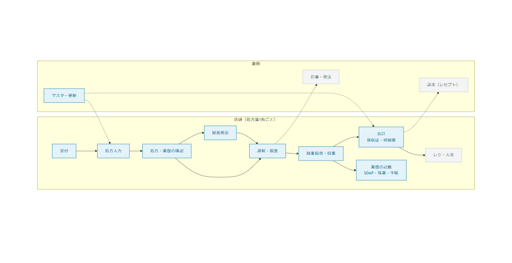

# ワークフロー定義書

保険薬局で、処方箋1枚を受け付けてから薬歴を書き終えるまでの全工程を、工程ごとに「誰が・何で・何を入力し・何が残り・なぜ要るか」で定義する。このアプリで何を作り、何を作らないかは、すべてこの文書から決める。

- 確かめた資料は末尾の「出典」。確かめられなかったことは **（未確認）** と書く
- 2026-11-07 時点。現行の規定で書く（施行前の改正は「改正予定」と書く）

## 1. このアプリの目的

**次にその患者を担当する人（明日の自分や同僚）が、今日の問診の続きから始められること。**

月に1回しか来ない患者にとっても、今日は2回目・3回目の続きで、前に話したことを覚えている。前に話した内容が考慮されない、アレルギーが無視される、頼んだことが伝わっていない、をなくすための記録を作る。会計（点数・負担額・領収証）は、そのやり取りの中で金額の食い違いを出さないために持つ。

工程をこのアプリで扱うかどうかは、次の2つで決める。

1. **続きのための記録になるか**：次の来局で読まれる記録を作る・使う工程か
2. **患者に渡す金額と書類が正しくなるか**：窓口の額・領収証・明細書に関わる工程か

どちらにも当たらない工程（機械の操作・国のシステムの操作・物の受け渡し）は扱わない。扱う範囲の上限は、株式会社ズーの製品（レセコン・電子薬歴・POS 連携）が担っている部分とする。

## 2. 登場する人と機械

| 名前 | 何か | 誰が使う |
|---|---|---|
| レセコン | 処方を入力すると、点数・患者の負担額・領収証・薬袋・お薬手帳のシールを出し、月末にレセプト（調剤報酬明細書）を作って請求する。薬局のシステムの中心 | 事務 |
| 電子薬歴 | 患者ごとの服薬指導の記録（SOAP・アレルギー・申し送り） | 薬剤師 |
| オンライン資格確認の端末 | マイナ保険証を読み、国のシステムから保険の資格（加入している保険・負担割合）を確かめる | 事務 |
| 調剤機器 | 錠剤・散薬の分包機、水剤の分注機、鑑査システム（重さ・画像・バーコード）。ズーは作っていない（富士フイルム・湯山製作所・タカゾノなど） | 薬剤師・補助員 |
| POS・レジ | 窓口でお金を受け取る。OTC 薬・日用品の物販も同じレジ | 事務 |
| 審査支払機関 | 社会保険診療報酬支払基金（会社員などの保険）と国民健康保険団体連合会（国保・後期高齢者）。レセプトを審査し、保険者の分を薬局に払う | — |

つながり方：処方はレセコンに1回だけ入力する。分包機・鑑査システムへは、日本薬剤師会の共通仕様 NSIPS でレセコンから処方データを送る。電子薬歴はレセコンの処方を受け取る。レジへは、レセコンが負担額を送るか、領収証のバーコードをレジで読む（つないでいない薬局では手で打ち直す。この二重打ちが業界の課題とされている）。

ズーの製品：GENNAI（源内。Windows のレセコン）、kusudama（2016年〜。レセコン・タブレット薬歴・POS・クラウド本部）、kusudamaクラウド（2024年〜。レセコンと電子薬歴が一体のブラウザ版）。

## 3. 工程の定義

全体の流れ（左から右へ。青がこのアプリで扱う工程、灰色が扱わない工程。点線はマスター・請求・在庫とのつながり）。

表の列：**誰が**／**何で**／**入力すること**／**残る記録**／**なぜ要るか（根拠）**／**このアプリ**

### 3-1. 受付（事務）

| # | 工程 | 誰が | 何で | 入力すること | 残る記録 | なぜ要るか（根拠） | このアプリ |
|---|---|---|---|---|---|---|---|
| 1 | 処方箋を受け取る | 事務 | 紙 | 受付の時刻 | 受付・待ち時間 | 処方箋には使用期間がある（交付日を含めて4日。医師側の療養担当規則、条番号は未確認）。スタッフ間で「誰がどこまでやったか」を共有する | **扱う**（受付状況）。待ち時間と進み具合は複数のスタッフで共有する記録 |
| 2 | 保険の資格を確かめる | 事務 | オンライン資格確認の端末／保険証 | 保険者番号・負担割合・**公費の受給者証** | 患者の負担割合・公費 | 負担割合で一部負担金が決まる（健康保険法74条）。公費の受給者証に月の上限額が書いてある | **扱う**（負担割合・公費の登録と変更）。端末の操作そのものは国のシステムなので扱わない |
| 3 | お薬手帳を預かる | 事務 | 紙・電子版 | 提示の有無 | 処方の「手帳の提示」 | 手帳の提示の有無で服薬管理指導料の区分が変わる（調剤報酬点数表） | **扱う**（処方入力の「お薬手帳」） |
| 4 | 初めての患者に質問票を書いてもらう | 患者→事務 | 紙 | アレルギー・副作用歴・併用薬・妊娠授乳・後発品の希望 | 患者メモ | 薬歴に記載が求められる項目（服薬管理指導料の通知 通則(4)） | **扱う**（患者メモ。1行1件、直せて、直す前も残る） |
| 5 | 後発品・先発品の希望を聞く | 事務 | 口頭 | 先発品の希望 | 処方の「（選）」のコード | 患者の希望で長期収載品を出すと、差額の一部が保険外の「特別の料金」になる（健康保険法86条、選定療養） | **扱う**（「（選）」のコードを選ぶ） |
| 6 | 待ち時間を伝える | 事務 | 口頭 | — | — | — | 工程1の待ち時間を見て伝える |
| 7 | 処方を入力する | 事務 | レセコン | 処方箋の記載（薬・1日量・用法・日数）、処方日・調剤日 | 処方 | 点数と負担額の計算、レセプト請求の元。薬価は調剤日で引く | **扱う**（処方入力。キーボードだけで打てる）。処方箋の QR コードの読み取りは扱わない（薬名は3文字で候補が決まり、DB から選ぶので打ち間違いが起きにくい。読み取り機の費用と手間に見合う利点が、このアプリの目的からは立たない） |
| 8 | 薬袋・薬剤情報提供書・手帳シール・領収証を出す | 事務 | レセコン・プリンター | — | — | 領収証の交付義務（療担規則4条の2。明細書も無償で）。公費の患者にも求めがあれば明細書（4条の2の2） | **領収証・明細書・お薬手帳は扱う**。薬袋・薬剤情報提供書は扱わない（薬の写真・効能は医薬品データベースの情報で、このアプリは持っていない） |

### 3-2. 調剤（薬剤師）

| # | 工程 | 誰が | 何で | 入力すること | 残る記録 | なぜ要るか（根拠） | このアプリ |
|---|---|---|---|---|---|---|---|
| 9 | 処方監査 | 薬剤師 | 電子薬歴・処方箋・お薬手帳 | 確かめたこと | 引き継ぎの確認 | 処方に疑問があれば、医師に確かめるまで調剤してはならない（薬剤師法24条）。前回の申し送り・アレルギー・併用薬を今日の処方と照らす | **扱う**（薬歴：注意点・前回の P・処方の変化、引き継ぎのチェックリスト） |
| 10 | 疑義照会 | 薬剤師 | 電話 | 照会の内容・回答・処方が変わったか | 疑義照会の記録 | 薬剤師法24条。照会で処方が変われば加算がある（調剤管理料の加算） | **扱う**（処方入力の疑義照会。会計に加算が入る） |
| 11 | 棚から薬を取る・分包する | 薬剤師・補助員 | 棚・分包機 | — | — | — | **扱わない**（機械の操作。データはレセコンから NSIPS で送る） |
| 12 | 鑑査 | 別の薬剤師 | 目視・鑑査システム | 照合の結果 | 監査の記録 | 調剤した薬が処方と合っているかを別の目で確かめる。薬局のヒヤリ・ハットは調剤のときに最も多く、中でも数量間違い・規格や剤形の間違い・薬剤の取り違えが多い（日本医療機能評価機構の年報）。薬の箱と調剤包装（PTP シートなど）には GS1 バーコードが表示されている（厚労省通知、2015年7月出荷分から） | **扱う**（調剤監査：箱のバーコードと処方の照合）。ただし要否は 5章で判断を分ける |

### 3-3. 投薬（薬剤師）

| # | 工程 | 誰が | 何で | 入力すること | 残る記録 | なぜ要るか（根拠） | このアプリ |
|---|---|---|---|---|---|---|---|
| 13 | 呼んで本人を確かめる | 薬剤師 | — | — | 進み具合 | 取り違え防止 | 進み具合（投薬した）だけ |
| 14 | 体調・副作用・飲み忘れ・残薬・他院の薬・要望を聞く | 薬剤師 | 口頭 | 会話 | 指導記録の S・O | 薬剤師法25条の2（情報提供・指導）、服薬管理指導料の要件。残薬があれば疑義照会で日数を減らす | **扱う**（指導記録。会話の録音と文字起こしは固定の結果で代用） |
| 15 | 使い方を説明する | 薬剤師 | 薬剤情報提供書 | — | 指導記録の P | 同上 | 指導記録に書く |
| 16 | お薬手帳にシールを貼る・電子版に渡す | 薬剤師 | 手帳 | — | お薬手帳に渡した内容 | 他の医療機関・薬局との重複・相互作用を防ぐ | **扱う**（紙に貼る内容と、電子版の QR コード〔JAHIS Ver.2.0〕） |
| 17 | 会計 | 事務 | レジ | 受け取った額 | 会計済み | 一部負担金の受領（健康保険法74条）。10円未満は四捨五入（同75条） | **扱う**（窓口の額の計算、領収証、会計済み）。レジとの連携は扱わない（相手の機械が無い） |

### 3-4. 記録と、その後（薬剤師）

| # | 工程 | 誰が | 何で | 入力すること | 残る記録 | なぜ要るか（根拠） | このアプリ |
|---|---|---|---|---|---|---|---|
| 18 | 薬歴を書く | 薬剤師 | 電子薬歴 | S・O・A・P、残薬、手帳の確認 | 指導記録 | 服薬管理指導料の要件。保存は3年（自立支援医療・生活保護・結核・小児慢性・難病に関わるものは5年とされる。根拠の通知は未確認）。電子の記録は真正性・見読性・保存性を満たす（医療情報システムの安全管理に関するガイドライン） | **扱う**（指導記録。追記だけ。患者メモは直せて、直す前も残る） |
| 19 | 電子処方箋の調剤結果を登録する | 薬剤師 | 電子処方箋管理サービス | — | — | 国のシステム | **扱わない** |
| 20 | 処方医に情報を送る（トレーシングレポート） | 薬剤師 | FAX | 服薬状況・提案 | 送った報告書 | 急がない情報を医師に伝える（服薬情報等提供料に関わる） | **扱う** |
| 21 | 服薬期間中のフォローアップ | 薬剤師 | 電話・LINE | 体調の聞き取り | 指導記録 | 薬機法（2020年改正）で、必要に応じて服薬期間中も状況を確かめる義務（条番号は未確認） | **扱う**（つながる薬局。受信はデモ） |
| 22 | 在宅訪問 | 薬剤師 | 訪問 | 計画・訪問記録・報告書 | 在宅の記録 | 在宅患者訪問薬剤管理指導（計画書・報告書が要件。回数の上限あり） | **扱う**（計画・予定・記録・報告書。点数は扱わない） |

### 3-5. 裏側

| # | 工程 | 誰が | 何で | なぜ要るか | このアプリ |
|---|---|---|---|---|---|
| 23 | マスターの更新 | レセコンのメーカー | 支払基金の医薬品マスター・調剤行為マスター | 薬価は毎年（年度の途中にも品目ごとに）、調剤報酬は2年ごとに変わる。調剤日の薬価・点数で計算しないと金額が食い違う | **扱う**（このアプリの核） |
| 24 | レセプトの作成と請求 | 事務 | レセコン→オンライン請求 | 保険者の分を受け取る | **扱わない**（2026-11-05 の判断） |
| 25 | 在庫・発注 | 事務 | 在庫システム | — | **扱わない**（続きの記録にも、患者に渡す金額にも関わらない） |
| 26 | 薬局の数字（処方箋単価・後発品の使用割合） | 管理者 | 集計 | 後発医薬品の使用割合で、調剤基本料の加算（後発医薬品調剤体制加算）の届出の区分が決まる | **扱う**（薬局の数字） |

## 4. 1枚の処方箋のお金の流れ

| 段階 | 計算 | 根拠 |
|---|---|---|
| ① 薬剤料 | 1剤1日分の薬価合計が15円以下は1点、15円を超えたら10円またはその端数ごとに1点を足す。それに日数を掛ける。薬価は調剤日のもの | 薬価基準（告示）、調剤報酬点数表 区分20 |
| ② 調剤報酬 | 調剤基本料・薬剤調製料・調剤管理料・服薬管理指導料と加算。調剤日の点数表で出す | 調剤報酬点数表（2年ごと。令和8年6月1日に改定） |
| ③ 医療費 | 合計点数 × 10円 | 同上 |
| ④ 一部負担金 | 医療費 × 負担割合。10円未満は四捨五入 | 健康保険法74条・75条、高齢者医療確保法 |
| ⑤ 公費 | 一部負担金のうえで、さらに患者の負担を減らす。国の公費（自立支援医療・難病など）→ 自治体の助成 の順にかける | 各法と自治体の条例（下の 4-2） |
| ⑥ 選定療養 | 患者の希望で先発品を出したときの特別の料金（保険外） | 健康保険法86条 |
| ⑦ 窓口で受け取る額 | ④⑤の後の患者負担 ＋ ⑥ | — |

### 4-1. 負担割合（④）

保険証（資格確認）に書かれた割合を使う。年齢で標準が決まり、所得や事情で変わる。

| 区分 | 割合 |
|---|---|
| 小学校に上がる前（6歳に達した日以後の最初の3月31日まで） | 2割 |
| 小学生〜69歳 | 3割 |
| 70〜74歳（70歳に達した日の翌月1日から。達した日が1日ならその月） | 2割（現役並み所得は3割） |
| 75歳以上（75歳の誕生日から。後期高齢者医療） | 1割（一定以上の所得は2割、現役並み所得は3割） |
| **65〜74歳で一定の障害があり、広域連合の認定を受けた人** | 後期高齢者医療に入り、1割（所得で2割・3割） |
| **一部負担金の免除**（災害・急な収入の減少などで保険者が認めたとき。国民健康保険法44条） | 0（期間を限る） |
| 生活保護（健康保険から外れ、医療扶助で払う） | 0 |

「〇歳に達した日」は誕生日の前日（年齢計算ニ関スル法律）。70歳以上の割合は毎年8月1日に前年の所得で見直される。

一部負担金の**減額**（「5割減額」のように割合でなく割り引く形）はこのアプリでは扱わない。件数が少なく、保険者ごとに形が違う。

### 4-2. 公費（⑤）

患者は受給者証を見せる。受給者証には、公費負担者番号（先頭2桁が法別番号）・受給者番号・有効期間・**自己負担の上限月額**が書いてある。上限のある公費は「自己負担上限額管理票」を患者が持ち、薬局は来局のたびに医療費総額と自己負担額を書き込み、月の累計が上限に達したらそれ以降は取らない。

| 公費 | 法別番号 | 患者の負担 |
|---|---|---|
| 生活保護 | 12 | 0（4-1 の負担割合 0 として扱う） |
| 自立支援医療（精神通院） | 21 | 医療費の1割。月の上限（0・2,500・5,000・10,000・20,000円、または上限なし） |
| 小児慢性特定疾病 | 52 | 2割（保険の割合がそれより低ければ保険の割合）。月の上限 |
| 指定難病 | 54 | 2割（保険の割合がそれより低ければ保険の割合）。月の上限 |
| 自治体の助成（子ども・ひとり親・重度心身障害者） | 自治体ごと | 自治体ごとに、無料／1回いくら／月の上限。**薬局は無料の自治体が多い**（松江市・福岡県の基準・木更津市） |

公費を重ねるときは、国の公費を先にかけ、自治体の助成を後にかける（全体の優先順位の一覧は未確認）。公費の分の端数の処理（10円未満の扱い）は未確認のため、このアプリでは一部負担金と同じく10円未満を四捨五入する。

1枚の処方の中に公費の対象の薬と対象外の薬が混ざる場合の分け方は扱わない。処方1枚ごとに、使う公費を選ぶ。

## 5. 今の機能の棚卸し

すべての機能を、3章の工程と1章の2つの基準に照らした。

| 機能 | 工程 | 基準 | 判断 |
|---|---|---|---|
| 患者一覧・登録 | 2・4 | 続きの記録 | 残す |
| 受付状況（進み具合・待ち時間） | 1・6・13・17 | 続きの記録（スタッフ間で今どこかを共有） | 残す。領収証・お薬手帳はここ（事務の画面）の該当する段階から出す |
| 処方入力・会計 | 3・5・7・10・17 | 両方 | 残す |
| 負担割合 | 2 | 金額 | 残す。例外（65〜74歳の障害認定・免除）を足す |
| 公費 | 2・17 | 金額 | **足す** |
| 薬歴（注意点・次に確認すること・経過・処方の推移） | 9・18 | 続きの記録 | 残す。引き継ぎのチェックリストを足す |
| 患者メモ | 4・9 | 続きの記録 | 残す |
| 指導記録（SOAP）・下書き・提案・テンプレート・文字起こし | 14・15・18 | 続きの記録 | 残す |
| 検査値・体重 | 9 | 続きの記録（腎機能で量を確かめる。小児は体重で量を確かめる） | 残す |
| 小児の分量 | 9 | 続きの記録（体重の記録を使う監査） | 残す |
| 領収証・明細書 | 8・17 | 金額 | 残す。薬歴の画面からは外し、受付状況の会計から出す |
| お薬手帳 | 16 | 続きの記録（他の医療機関への引き継ぎ） | 残す。受付状況の投薬から出す |
| 調剤監査（箱のバーコード） | 12 | どちらにも直接は当たらない（調剤の安全） | **判断を分ける**：残す根拠は、規格違い・取り違えのヒヤリ・ハットが多いこと（年報）。外す根拠は、目視の鑑査が基本で、機材と手間がかかり、法律の義務ではないこと。**削除はユーザーの判断待ち。それまでは残す** |
| トレーシングレポート | 20 | 続きの記録（医師への引き継ぎ） | 残す |
| つながる薬局 | 21 | 続きの記録 | 残す |
| 在宅 | 22 | 続きの記録 | 残す |
| 薬局の数字 | 26 | 金額（加算の届出の区分） | 残す |
| マスター取込・薬価照会 | 23 | 金額（核） | 残す |
| 閲覧記録 | — | 要配慮個人情報（個人情報保護法）を誰が見たかを残す | 残す |
| 多要素認証 | — | 医療情報システムの安全管理に関するガイドライン | 残す |
| 前回の処方を写す（Do） | 7 | 処方入力の補助 | 残す。処方入力の画面に置く（事務の工程） |

## 6. 画面と担当

| 画面 | 担当 | 並べる順 |
|---|---|---|
| 受付状況 | 事務 | 受付 → 処方入力 → 監査待ち → 投薬（お薬手帳を出す）→ 会計（領収証・明細書を出す）→ 会計済み |
| 処方入力 | 事務 | 負担割合・公費の確認 → 日付・手帳 → 処方 → 疑義照会 → 会計 → 保存 |
| 薬歴 | 薬剤師 | 患者 → 注意点・次に確認すること → **この来局の引き継ぎ（チェックリスト）** → 経過 → 指導記録・トレーシングレポート |
| 調剤監査 | 薬剤師 | 受付状況の「監査待ち」から |

### 薬歴の引き継ぎのチェックリスト（来局ごと）

全ての患者に、毎回同じことを確かめる。

| 項目 | 照らすもの | 付け方 |
|---|---|---|
| 前回の申し送り（P）に今日応えた | 前回の指導記録の P | 薬剤師が付ける |
| アレルギー・副作用歴・併用薬を今日の処方と照らした | 注意点・今日の処方 | 薬剤師が付ける |
| 処方が変わった理由を聞いた（変わったときだけ） | 前回との処方の差 | 薬剤師が付ける |
| 今日聞いたこと（S・O）と判断（A）を書いた | 今日の指導記録 | 指導記録を書くと付く |
| 次回に確かめること（P）を書いた | 今日の指導記録の P | P を書くと付く |

## 出典

- 厚生労働省：保険薬局及び保険薬剤師療養担当規則の改正資料（4条の2・4条の2の2・6条） https://www.mhlw.go.jp/content/10808000/001747687.pdf
- 厚生労働省：医療費の内容の分かる領収証及び個別の算定項目の分かる明細書の交付について https://www.mhlw.go.jp/file/06-Seisakujouhou-12400000-Hokenkyoku/0000114862.pdf
- 薬歴の保存期間の解説（PHC Medicom Park） https://www.phchd.com/jp/medicom/park/idea/ph-management-keep-medicationhistory
- 薬事日報：薬局ヒヤリ・ハット 2010年年報 https://www.yakuji.co.jp/?p=20786
- PMDA：調剤・疑義照会のヒヤリ・ハット事例（2025年1〜6月） https://www.pmda.go.jp/files/000280369.pdf
- 厚生労働省：医療用医薬品の新バーコード表示（2014年7月10日通知） https://www.mhlw.go.jp/file/06-Seisakujouhou-11120000-Iyakushokuhinkyoku/140710.pdf
- NSIPS の解説 https://www.issoh.co.jp/column/details/19010/
- 相模原市：65〜74歳の障害認定と後期高齢者医療 https://www.city.sagamihara.kanagawa.jp/shisei/1026875/faq/kenkou/1001476.html
- 静岡市：国民健康保険の一部負担金の減免 https://www.city.shizuoka.lg.jp/s8435/s000634.html
- 静岡市：自立支援医療（精神通院）の上限月額 https://www.city.shizuoka.lg.jp/s2498/s003320.html
- 広島県：自己負担上限額管理票の様式 https://www.pref.hiroshima.lg.jp/uploaded/attachment/455600.pdf
- 相模原市：指定難病の医療費助成 https://www.city.sagamihara.kanagawa.jp/kosodate/kenko/1026625/nanbyo/1007307.html
- 香川県：自己負担上限額管理票について https://www.pref.kagawa.lg.jp/documents/18959/kanrihyounituite-kuni.pdf
- 岡山県：公費負担者番号（法別番号） https://www.pref.okayama.jp/uploaded/life/590172_4877302_misc.pdf
- 徳島県：小児慢性特定疾病の法別番号 https://www.pref.tokushima.lg.jp/file/attachment/1037222.pdf
- 島根県松江市：子ども医療費助成 https://www.city.matsue.lg.jp/material/files/group/83/r6kodomoiryouhizyosei.pdf
- 福岡県：子ども医療費助成 https://www.pref.fukuoka.lg.jp/contents/kodomo-iryou.html
- 三重大学病院：院外処方箋の QR コード https://www.hosp.mie-u.ac.jp/pharmacy/upload/20240925-193726.pdf
